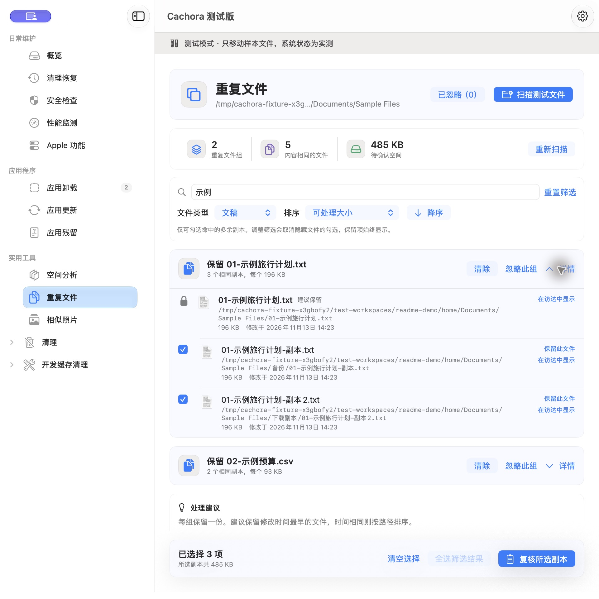
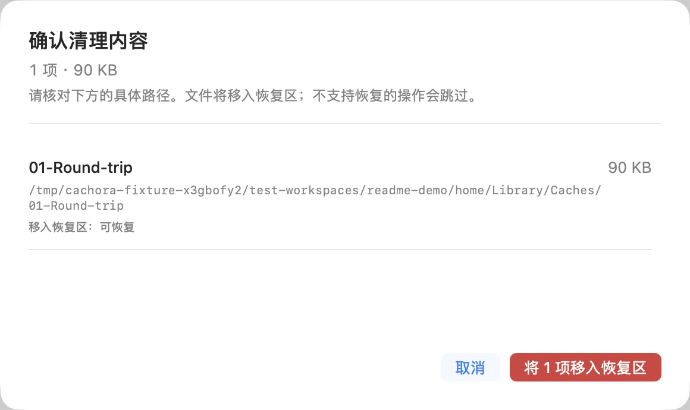
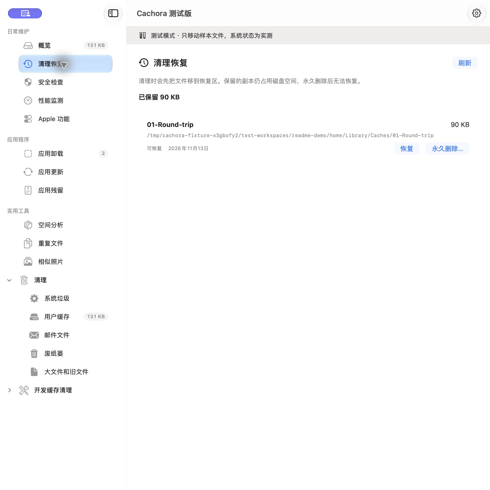

# Cachora · 轻盘


看清磁盘占用，复核要处理的文件，再清理或恢复。为 Mac 提供原生界面的空间分析、应用管理与可恢复清理工具。

A native Mac toolkit for storage, applications, and recoverable cleanup.

[](https://github.com/angelyxf/cachora/actions/workflows/build.yml)
[](LICENSE)

**当前版本：0.1.0 · Build 18。源码已开放，安装包暂不公开。** 这是面向本机使用验证的稳定构建，尚未完成自己的 Apple Developer ID 签名与公证；“稳定构建”不代表所有 Mac 配置均已验证。详见 [验证与发行状态](docs/RELEASE-STATUS.md)。

[源码编译](docs/BUILDING.md) · [功能截图](#使用截图) · [反馈问题](https://github.com/angelyxf/cachora/issues) · [隐私说明](PRIVACY.md)

## 功能一览

| 功能 | 可以做什么 |
| --- | --- |
| 空间总览与分析 | 查看磁盘容量、目录占用、大文件和旧文件；统计包含隐藏文件，无法读取的位置会提示，不能读不等于零占用。 |
| 缓存与文件清理 | 手动扫描系统垃圾、用户缓存、邮件文件、废纸篓，以及 AI、Xcode、Node、Homebrew、Docker 相关项目；区分可处理项与仅供查看项，复核实际路径后再操作。 |
| 清理恢复 | 可恢复项目先移入本地恢复区，保留原位置与操作记录；恢复遇到同名文件时拒绝覆盖，处理冲突后可以重试。 |
| 重复文件 | 比对文件内容，按名称或路径搜索、按类型筛选，支持三种双向排序；提供保留建议，也可指定保留项。筛选后全选只勾选命中的多余副本，每组至少留一份。 |
| 忽略与撤销 | 重复文件可“忽略此组”，在已忽略列表撤销；再次扫描相同目录时，文件或组成员变化会让忽略失效，重新纳入复核。 |
| 应用管理 | 查看应用及关联缓存、偏好设置、日志，复核后卸载；支持访达右键服务进入卸载复核，也可单独扫描疑似应用残留。 |
| 应用更新 | 提供 App Store 更新入口；已安装 Homebrew 时，可检查它管理的软件。Homebrew 是可选的命令行软件管理器，普通扫描和清理不依赖它。设置中的“检查轻盘更新”只检查 Cachora 自身。 |
| 相似照片与 Apple 功能 | 查看疑似相似图片，人工复核后处理并保留至少一张；查看 Apple 资源占用，处理本地设备备份前再次确认。相似不等于内容完全相同。 |
| 系统状态与扫描计划 | 查看安全设置与性能状态；可在设置中启用定时扫描，仅在应用运行时执行，移动文件仍需手动复核。 |

## 先了解文件会去哪里

1. **扫描**：选择需要检查的类别或文件夹，查看结果与读取失败提示。
2. **复核**：勾选要处理的项目，确认文件路径、保留项和目标位置；正在变化或无法核验的文件会跳过并报告原因。
3. **处理与恢复**：普通可恢复清理进入左侧“清理恢复”；应用卸载、应用残留、重复文件和相似照片确认后移入系统废纸篓，应从访达废纸篓恢复。

**移入恢复区不等于释放空间。** 保留的副本仍占磁盘；恢复区是本地暂存位置，不是独立备份。永久删除副本需要再次确认，且不能通过 Cachora 撤销。移入废纸篓失败时保留原文件，不改用管理员永久删除。

## 使用截图

以下是 **Build 18 的真实界面**，只使用临时目录中生成的测试文件。为隔离真实数据，拍摄时启用了样本模式，所以窗口显示“测试版”和测试横幅；这不是另一个产品版本。截图没有真实文档、个人目录或已安装应用列表，显示的容量仅代表样本。

### 重复文件：筛选后批量选择，保留一份

搜索“示例”并筛选文稿后，点击“全选筛选结果”。两组文件只选中 3 份多余副本，保留项不会被勾选；可以展开分组核对路径，再进入复核。



### 清理前：确认范围和去向

只选择生成的 `01-Round-trip` 缓存，确认页列出临时目录中的实际路径，并注明“移入恢复区：可恢复”。



### 清理后：从记录恢复到原位置

“清理恢复”保留原路径、大小、时间与状态，并明确提示副本仍占空间。拍摄后已执行恢复，核对全部 40 个样本文件的内容、权限与扩展属性，均与操作前一致。



## 从源码开始

当前推荐 **Apple Silicon Mac + Python 3 + Apple 开发工具（Swift 与 macOS SDK）**。不需要 Homebrew、付费开发者账号或 Python 第三方依赖。脚本生成 arm64 应用，编译目标为 macOS 13；Intel 与其他系统的实际验证范围见 [发布状态](docs/RELEASE-STATUS.md)。

```sh
git clone https://github.com/angelyxf/cachora.git
cd cachora
python3 scripts/build-local-app.py
open build-local/Cachora.app
```

默认构建会先运行 92 项 Swift 样本检查，再编译应用、生成图标并验证本地临时签名。产物在项目的 `build-local/`，不会自动安装到 `/Applications`。直接打开普通应用会读取本机状态；**只想验证文件操作时，请先按 [隔离样本演示](docs/BUILDING.md#只用测试文件体验) 打开样本应用。**

环境检查、完整命令、日志位置和常见编译问题见 [源码编译与样本验证](docs/BUILDING.md)。

## 开发与验证

```sh
python3 scripts/build-local-app.py --tests-only
python3 -m unittest discover -s scripts/tests -v
python3 scripts/prepare-beta.py --check
```

92 项 Swift 检查覆盖扫描、恢复、完整源码集成、更新与重复文件规则；另有 23 项 Python 检查覆盖打包和公证状态控制，Apple 服务响应使用模拟。完整上游 XCTest 未全部执行。GitHub Actions 会从源码构建并运行这些检查，最新结果可从页面顶部状态链接查看。

本地临时签名不等于 Developer ID 签名或 Apple 公证。安装包的后续准备流程见 [构建与发布说明](docs/BETA-RELEASE.md)，当前没有公开的 Build 18 DMG / ZIP 下载。

## 隐私与反馈

文件名、内容、扫描结果与恢复记录留在本机。手动检查轻盘更新会请求本仓库的 GitHub Releases API；Homebrew 检查或更新会使用其配置的软件源。详见 [隐私说明](PRIVACY.md)。

请在 [Issues](https://github.com/angelyxf/cachora/issues) 提供系统版本、芯片类型、Build 号、预期行为，以及能用测试文件复现的步骤。上传前遮盖截图和日志中的私人路径，不上传实际文档、密钥或恢复副本。

当前没有收费入口。自定义规则、空间变化报告等属于后续候选，尚未实现，也没有订阅或终身更新承诺。

## 来源与许可

本项目基于 [PureMac](https://github.com/momenbasel/PureMac) 独立开发，固定源码基线为 `b86aa61948f78ae9f17b42b624b20357a3ca9ffe`。保留 [MIT 许可](LICENSE) 和原作者信息，使用独立名称与图标；详见 [第三方说明](THIRD-PARTY-NOTICES.md)。源码模块与历史目录仍保留 PureMac，便于审查来源。本项目不代表原作者或 Apple。

## English

Cachora is an independent, MIT-licensed PureMac derivative for storage analysis, application management, duplicate review, and recoverable cleanup. Review paths before moving eligible files into local Recovery; retained copies still occupy disk space. App uninstallation and file comparison tools use the system Trash.

Build 18 source is available. Installers are not publicly distributed, and Developer ID signing and Apple notarization are pending. The build script targets Apple Silicon. All screenshots use generated fixtures, not personal files. See [build instructions](docs/BUILDING.md) and [tested configurations](docs/RELEASE-STATUS.md).
